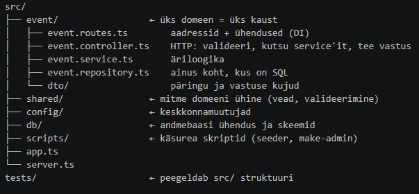

# Piletirakenduse backend

Ehitan selle rakenduse koolitöö raames. Rakendus on loodud Node.js ja Express raamistikus ning selle eesmärk on pakkuda kasutajatele võimalust hallata erinevaid sündmusi, sealhulgas registreeruda, vaadata sündmuste ajakava ja saada teavitusi.

Issued tehakse järjekorras ja iga hilisem sõltub varasematest.

**Alusta siit: [ALUSTA.md](ALUSTA.md)**

> [!IMPORTANT]
> Pane tähele, mida meil selle projekti jaoks vaja läheb ning valmista oma arenduskeskkond vastavalt sellele. Nimekirjas on Docker, NodeJS versioonid ja palju muud.

**Käsud**

#1: node -v

#2: npm init -y

#3: npm install express

#4: npm install -D typescript tsx @types/node @types/express

#5: npm run typecheck

#6: npm run server

#7: npm install -D prettier oxlint

#8: npx oxlint --init

#9: npm run format

#10: npm run lint

#11: npm run format:check

---

Kood on kaustades domeeni kaupa, mitte kihi kaupa. Kõik ürituse failid on koos, mitte "kõik controllerid ühes kaustas":

